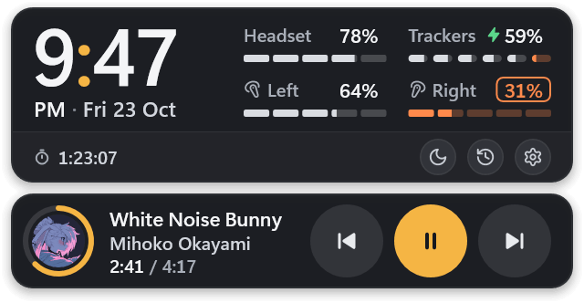
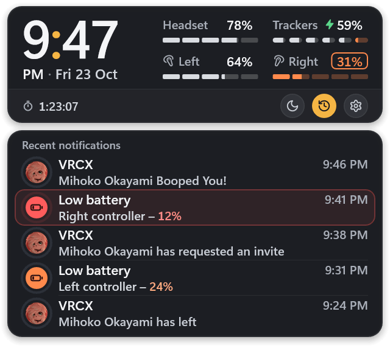
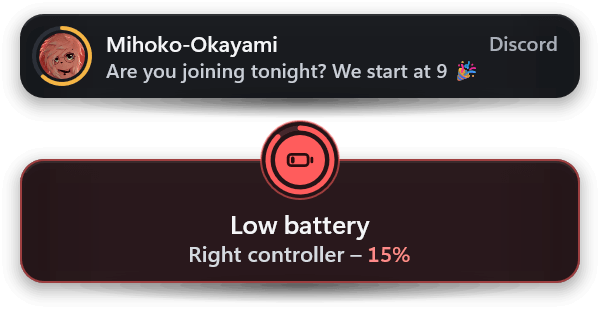
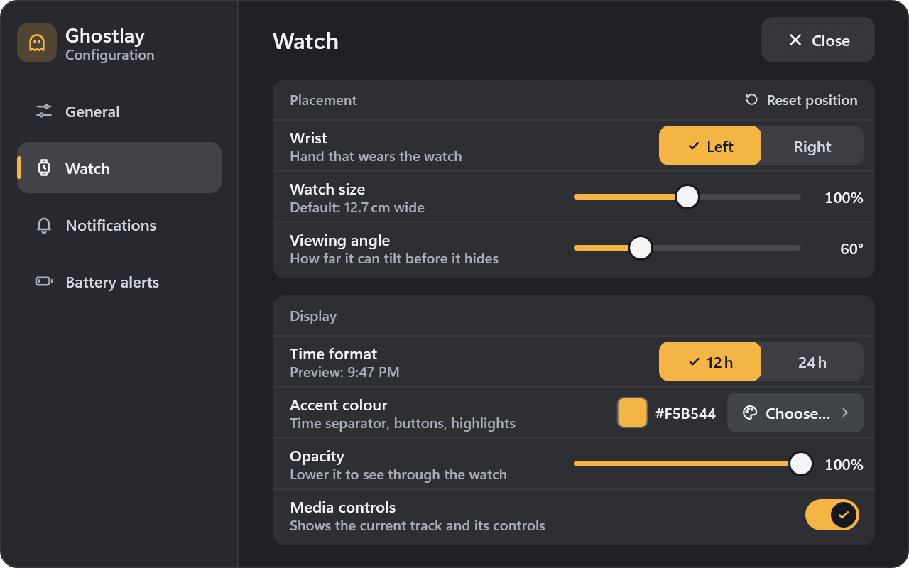
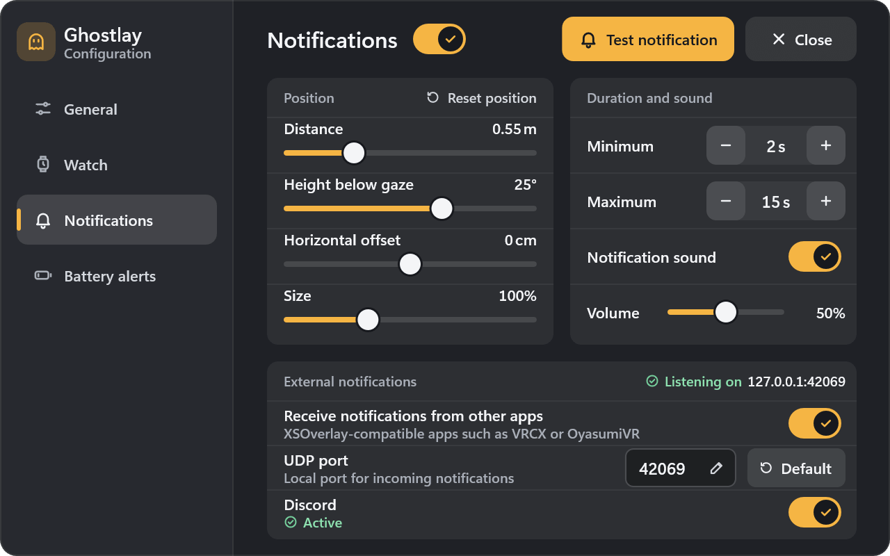
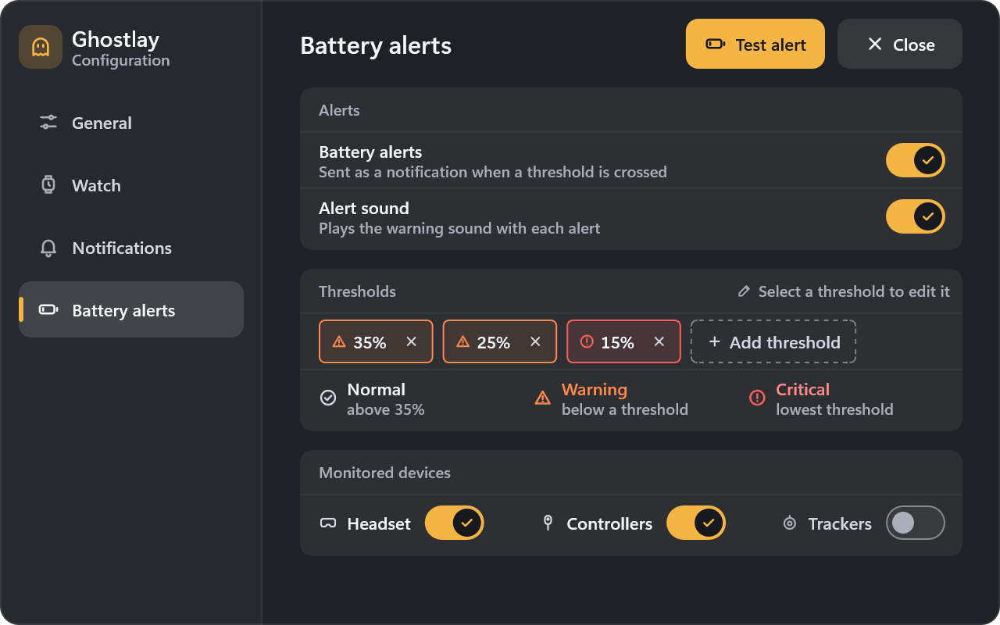

# Ghostlay

A light SteamVR overlay for Windows: a wrist watch, notifications and battery alerts, in a single 200 KB program.

  
  

## Watch

Look at your wrist to see the time, how long you have been in VR and the battery of your headset, controllers and trackers (up to 32). The music playing on your computer shows below, with its controls.

The three buttons turn on Do not disturb, open the history of the last 20 notifications and open the settings.

## Notifications

- **Apps:** anything that sends notifications to XSOverlay, such as VRCX, works with Ghostlay.
- **Discord:** messages from the Discord desktop app, with avatars. Ghostlay reads the notifications Windows receives: no modified client, no account access.
- **Battery alerts:** when a device drops to 35, 25 or 15 %, or to the thresholds you choose.
- **Do not disturb** sends notifications straight to the history. Critical battery alerts still show.

  

## Settings

Everything is set in VR, in English or French.

## Install

Download `ghostlay.exe` from the [latest release](https://github.com/Mihoko-Okayami/Ghostlay/releases/latest), put it anywhere and run it. It waits for SteamVR if SteamVR is not running yet.

Ghostlay is portable: its settings and logs are in `%APPDATA%\Ghostlay`, and nothing is registered in SteamVR unless you turn on **Launch with SteamVR** in the General settings.

## Use

- Point at the watch or the settings with either controller and pull the trigger, like in XSOverlay.
- Click the Trackers cell of the watch to list every tracker. In this list and in the history, the thumbstick scrolls.
- Hold the grip on the settings, or the trigger on the bar below them, to move them. While holding, the right thumbstick pushes them away or brings them closer.

If the trigger does nothing, reapply the default bindings of Ghostlay in the controller settings of SteamVR.

## Discord

The Discord desktop app must be running with its desktop notifications on, and Windows must let apps access notifications (Settings › Privacy & security › Notifications). Windows Do not disturb does not hide them in VR, but Discord's own Do not disturb and mutes do.

## Notifications from other apps

Ghostlay listens on `127.0.0.1:42069` for the notification messages of the [XSOverlay API](https://xiexe.github.io/XSOverlayDocumentation/). The port can be changed in the Notifications settings. If another app already uses it, Ghostlay shows which one and tries again every 10 seconds.

## License

Copyright © 2026 Mihoko-Okayami. Ghostlay is released under the [GNU General Public License v3.0](LICENSE): you can use, share and modify it, and any version you distribute must keep this license and this copyright notice, and come with its source code. It is built with the headers of [OpenVR](https://github.com/ValveSoftware/openvr) (BSD 3-Clause) and uses the SteamVR installed on your computer.
